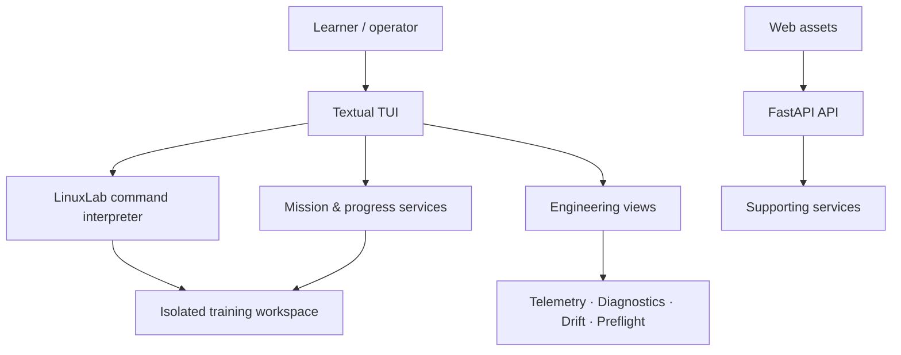

<div align="center">

# FORGE

### LINUX ENGINEERING WORKBENCH

**Linux fundamentals, guided practice, and engineering workflows in one terminal-based workbench.**

An interactive, safety-conscious Linux learning environment combining a guided CLI lab, engineering diagnostics, and practical operational workflows — built for **DecodeLabs DevOps Project 1: Linux & Command Line Basics**.

[](https://github.com/HaziqBinAfzal/FORGE-Linux-Engineering-Workbench/actions/workflows/ci.yml)


[Overview](#overview) · [Capabilities](#what-forge-can-do) · [Quick start](#quick-start) · [CLI reference](#linux-command-reference) · [Guided mission](#the-six-step-web-app-setup-mission) · [Architecture](#architecture) · [Safety](#designed-for-safe-learning)

</div>

---

## Overview

FORGE (Linux Engineering Workbench) is an interactive, terminal-first application for learning how Linux commands work and how command-line skills support everyday engineering and operations tasks. It combines a guided Linux practice environment with system observation, diagnostic views, operational checks, and structured exercises in one workbench. The goal is to make the transition from memorizing commands to using them with purpose: understanding the filesystem, inspecting evidence, making deliberate changes, and verifying what happened afterward.

It was developed as an implementation of **DecodeLabs DevOps Project 1: Linux & Command Line Basics**. That project introduces foundational skills such as navigating directories, manipulating files, understanding the Linux filesystem hierarchy, reading logs, working with permission bits, and handling common administrative command syntax. Instead of relying on isolated commands or a static command list, FORGE turns the learning objectives into an application in which users can practice commands and complete a verifiable, six-step web-application setup mission. The additional engineering workspaces extend the learning context beyond the minimum assignment exercises.

### Why FORGE was made

Command-line tutorials often teach a command in isolation, but real work requires knowing **when to use it, what it will affect, how to interpret its output, and how to recover from mistakes**. A beginner can learn that `mv` renames a file without understanding why preserving log history matters, or memorize `chmod 754` without understanding which access rights those digits represent. Practicing directly in the host filesystem can also be intimidating, especially when paths, ownership, or deletion are involved.

FORGE was created to close that gap. Its bounded Linux lab provides a place to try supported commands against training files rather than the machine's system directories. Its guided mission turns the concepts into a coherent task, and its engineering views introduce the observational habits used in operational troubleshooting: inspect state, look for changes, check readiness, and reason about the output before acting.

### Who it is for

FORGE is designed primarily for **students, early-career DevOps learners, Linux beginners, and engineering practitioners** who want a structured refresher on basic command-line workflows. It is also useful as a demonstrable portfolio project showing Python application structure, a terminal UI, filesystem safety checks, automated testing, and continuous integration.

It is **not** intended to replace Bash, administer production infrastructure, or act as a security boundary for untrusted workloads. The training interpreter supports a deliberate subset of commands, and several operations are simulated. Its real-host monitoring and helper scripts should be understood separately from the bounded Linux lab.

## What FORGE can do

FORGE brings together the following capabilities:

| Capability | What it provides | Practical value |
|:--|:--|:--|
| **Interactive Linux practice** | Execute supported navigation, directory, file, permission, inspection, and redirection commands inside a controlled training workspace. | Build command familiarity without relying on destructive experiments in host system directories. |
| **Guided assignment mission** | Work through a six-step web-app setup exercise and have file state and command history checked for completion. | Connect Linux fundamentals to a realistic, observable outcome. |
| **Filesystem and permissions education** | Explore common Linux path roles, file listings, numeric modes, identity, and ownership concepts. | Understand both command syntax and the meaning of command output. |
| **Log and file inspection** | Use `cat`, `head`, `tail`, simplified `less`, and a bounded `tail -f` demonstration. | Learn to inspect configuration files and operational evidence. |
| **Process and system overview** | Access terminal-based system and process-oriented information views. | Develop an initial understanding of system observation. |
| **Engineering diagnostics** | Explore diagnostics and structured troubleshooting views. | Build a habit of reviewing evidence before making changes. |
| **Drift and preflight checks** | Review change-oriented signals and readiness checks in dedicated workspaces. | Introduce operational verification and configuration-awareness concepts. |
| **Operational utilities** | Use the included setup, monitoring, backup, verification, recovery-test, and security-audit scripts when appropriate. | Demonstrate how Linux projects organize repeatable engineering tasks. |
| **Automated quality checks** | Run a dedicated Python test suite locally and in GitHub Actions. | Provide repeatable confidence that supported functionality still works after changes. |

The interactive workbench is built around a **Textual terminal interface** with supporting Python services. A **FastAPI entry point**, web assets, and Bash helper scripts are also included in the source tree. The sections below explain the practical workflow, implementation boundaries, and ways to run and test the project.

## How the workbench is used

A typical learning session starts by launching FORGE in an Ubuntu or Linux terminal, selecting a relevant workbench area, and entering supported commands in the **FORGE command input**. The learner reads the resulting output and uses it to decide what to do next. In the official mission, each step creates or inspects evidence in the lab workspace so that progress is based on the task state rather than an arbitrary completion button.

For example, a learner can create application folders, write a startup log, inspect the directory tree, rename the log file, and review file permissions. They can then move to engineering-oriented views to explore how command-line information relates to monitoring and troubleshooting. This is an educational workflow; the separate system views and shell scripts are not all protected by the Linux lab's virtual-path restrictions.

## Learning model

Linux commands become more useful when learners understand the result, not only the syntax. The training lab encourages this by letting a learner perform a command, inspect its effects, and decide on the next step.

Rather than presenting a static cheat sheet, FORGE brings together three complementary experiences:

| Learn | Practice | Investigate |
|:--|:--|:--|
| Understand navigation, files, permissions, logs, and identity concepts. | Run supported commands inside a bounded, filesystem-backed training lab. | Explore process information, diagnostics, drift, preflight checks, and engineering missions. |
| **CLI fundamentals** | **Guided hands-on mission** | **Engineering-oriented tooling** |

> **Important:** The FORGE Linux lab is *not* a full Bash shell. Supported commands operate within an isolated training workspace. Some commands intentionally simulate real-world behaviors; see [Safety and limitations](#designed-for-safe-learning).

## Workspaces inside FORGE

The four primary workspaces use shortcuts `1`–`4`. Additional tools remain accessible through `5` (Drift), `6` (Preflight), and `7` (incident practice).

FORGE provides a terminal-oriented experience with dedicated engineering views. The primary training experience is an **interactive command input**: enter a supported command, inspect the output, and advance your mission as the required evidence is created.

| Workspace | What you can explore |
|:--|:--|
| **Overview** | Entry point for system and workbench context. |
| **Processes** | Process-oriented monitoring views. |
| **Diagnostics** | Inspect operational signals and troubleshooting information. |
| **Engineering** | Practice Linux commands in the isolated lab and complete the six-step DecodeLabs mission. |
| **Drift** | Examine changes or deviations in the monitored environment. |
| **Preflight** | Review preflight-style checks and readiness information. |
| **Missions** | Access optional incident practice using shortcut `7`. |
| **Linux lab** | Integrated into Engineering (`4`), rather than a separate main workspace. |

### The project at a glance

```text
FORGE — Linux Engineering Workbench
│
├── Interactive terminal interface (Textual)
│   ├── Overview / Processes / Diagnostics
│   ├── Engineering / Drift / Preflight
│   └── Missions + Linux command input
│
├── Safe Linux training services
│   ├── Virtual-path filesystem workspace
│   ├── Command parsing and bounded execution
│   ├── Permissions, identity and file inspection
│   └── Six-step mission verification
│
├── Engineering services
│   ├── Telemetry and monitoring
│   ├── Diagnostics, drift and preflight
│   └── Mission and progress handling
│
├── API and web assets
└── Operational helper scripts + automated tests
```

The training lab operates on workspace-backed files, while additional engineering views may inspect real host information. **Do not assume every workbench feature is sandboxed in the same way as the Linux lab.**

---

## Quick start

### Requirements

- **Ubuntu/Linux** (including Ubuntu on Windows Subsystem for Linux)
- **Python 3.14** for the environment verified in this release
- Python virtual-environment support (`venv`)
- Internet access for the initial dependency installation

### 1. Clone the repository

```bash
git clone https://github.com/HaziqBinAfzal/FORGE-Linux-Engineering-Workbench.git
cd FORGE-Linux-Engineering-Workbench
```

### 2. Create an isolated Python environment

```bash
python3 -m venv .venv
.venv/bin/python -m pip install -r requirements.txt
```

> If your system's `python3` is not Python 3.14, use the installed Python 3.14 executable to create the virtual environment. Other Python versions have not been established as supported by this release's verification.

### 3. Launch FORGE

```bash
./forge-run
```

The launcher starts the project's terminal interface. **Use the command input inside FORGE** for simulated commands such as `mkdir -p /app/logs`; typing these into your actual Ubuntu shell will target the *real* host filesystem.

### 4. Run the automated tests

```bash
PYTHONPATH=. .venv/bin/python -m pytest tests/forge -q
```

**Verified release baseline:** 96 passing tests, including a fresh-virtual-environment installation check. GitHub Actions runs the FORGE suite on pushes and pull requests.

---

## Linux command reference

The following describes commands supported by the **FORGE training lab**, not a promise of complete GNU/Linux command compatibility.

| Topic | Commands | Learning outcome |
|:--|:--|:--|
| Navigation | `pwd`, `cd`, `ls` | Know where you are and what is present. |
| Listing modes | `ls -a`, `ls -l`, `ls -R`, `ls -la` | Inspect hidden entries, metadata, and nested paths. |
| Directories | `mkdir -p` | Build a directory structure, including intermediate directories. |
| Files | `touch`, `cp`, `mv` | Create, copy, and move or rename files. |
| Inspect contents | `cat`, `less`, `head`, `tail` | Read complete, initial, or final portions of files. |
| Logs | `tail -f` | Understand log-following semantics through a bounded demonstration. |
| Permissions | `chmod` | Practice numeric file-mode changes. |
| Ownership | `chown` | Understand ownership syntax through a simulation. |
| Identity | `whoami`, `id` | Explore illustrative user and group identity output. |
| Remote access | `ssh` | Learn command syntax without opening a network connection. |
| Safer deletion | `rm -i` | Confirm removal in a training setting. |
| Output redirection | `echo "text" > file` | Write text into a lab file. |
| Command sequence | `&&` | Run supported command sequences. |

### A short practice session

Run the following **inside FORGE**:

```bash
pwd
mkdir -p /practice/logs
touch /practice/config.conf
echo "Ready" > /practice/logs/app.log
ls -R /practice
cat /practice/logs/app.log
ls -l /practice/config.conf
```

The examples use virtual absolute paths, resolved inside the training workspace rather than against the root of your Ubuntu installation.

### Linux filesystem hierarchy: know the difference

| Real Linux directory | Common purpose |
|:--|:--|
| `/` | Filesystem root. |
| `/bin` and `/sbin` | Essential command and administrative program locations (often linked into `/usr` on modern systems). |
| `/boot` | Boot-related files. |
| `/dev` | Device interfaces. |
| `/etc` | System-wide configuration. |
| `/home` | Regular users' home directories. |
| `/root` | Root user's home directory. |
| `/tmp` | Temporary files. |
| `/usr` | Programs, libraries, and shared resources. |
| `/var` | Variable data such as logs and caches. |

FORGE teaches the meaning of these paths; its training root is **not** a full replica of a Linux installation.

### Understanding `chmod 754`

A numeric mode uses one digit each for **owner**, **group**, and **others**. Read = 4, write = 2, execute = 1.

```text
chmod 754 example.txt
      ││└─ others: 4 = read
      │└── group:  5 = read + execute
      └─── owner:  7 = read + write + execute
```

Changing a mode does not automatically grant access to every parent directory. Permission interpretation also depends on file type and the host operating system.

---

## The six-step Web App Setup mission

The core guided exercise follows **DecodeLabs DevOps Project 1: Linux & Command Line Basics**. It provides a concrete goal, rather than a disconnected list of commands.

**Mission objective:** Create a small `/app` structure, write a startup log, inspect the result, rename the log, and inspect file permissions.

| Step | Command entered in the FORGE lab | Why it matters |
|:--:|:--|:--|
| **01** | `mkdir -p /app/logs` | Create a dedicated location for application logs. |
| **02** | `touch /app/config.conf` | Create an application configuration placeholder. |
| **03** | `echo "Started" > /app/logs/server.log` | Write a recognizable startup event. |
| **04** | `pwd && ls -R /app` | Confirm location and inspect the app's directory tree. |
| **05** | `mv /app/logs/server.log /app/logs/server.bak` | Practice moving or renaming a log file. |
| **06** | `ls -l /app/config.conf` | Inspect file metadata and permission bits. |

### Expected final training structure

```text
/
└── app/
    ├── config.conf
    └── logs/
        └── server.bak    # contains: Started
```

The mission checks training files and command history, enabling evidence-based progress rather than awarding completion merely for typing arbitrary text. Progress is tracked within the FORGE training experience.

**Key distinction:** The path `/app/logs/server.log` in the mission refers to FORGE's lab. If you run the same line in normal Ubuntu and `/app/logs` does not exist, Bash will correctly report `No such file or directory`.

---

## Architecture



### Repository map

```text
.
├── forge-run                   # Main terminal launcher
├── requirements.txt            # Python dependencies
├── forge/
│   ├── tui/app.py              # Terminal user interface
│   ├── api/main.py             # API entry point
│   ├── services/
│   │   ├── linux_lab.py        # Lab path handling and execution
│   │   ├── linux_commands.py   # Additional supported commands
│   │   ├── webapp_mission.py   # Official six-step exercise
│   │   ├── webapp_persistence.py
│   │   ├── missions.py
│   │   ├── progress.py
│   │   ├── telemetry.py
│   │   ├── drift.py
│   │   └── preflight.py
│   └── web/                    # Web entry and static assets
├── app/                        # Application assets and example config
├── scripts/                    # Setup and operations helpers
├── tests/forge/                # FORGE automated test suite
├── .github/workflows/ci.yml    # CI test workflow
└── LICENSE                     # MIT License
```

### Engineering-oriented scripts

The `scripts/` directory includes helpers for setup, startup, verification, monitoring, live-log viewing, backup, recovery testing, operations, and security auditing. Review a script before running it: unlike commands inside the simulated Linux lab, shell scripts execute on the actual host environment.

---

## Designed for safe learning

FORGE intentionally favors **teachable, bounded behavior** over pretending to be a fully privileged system terminal.

| Feature | Behavior in FORGE |
|:--|:--|
| Filesystem operations in the lab | Confined to the training workspace using path validation. |
| `rm -i` | Confirmation-oriented practice. |
| `rm -rf` | Unrestricted recursive force deletion is not offered by the lab. |
| `ssh user@host` | Explanation/simulation only; no outbound SSH session. |
| `chown USER FILE` | Simulated ownership concept; no real host ownership change. |
| `whoami`, `id` | Illustrative training identity rather than host-account discovery. |
| `tail -f FILE` | Bounded training output; does not stay attached to a live stream. |
| Command support | A deliberately limited subset; unsupported shell behavior is not guaranteed. |

**Security boundary:** These safeguards describe the FORGE **Linux training interpreter**. They do not mean it is a hardened security isolation environment for hostile multi-user execution. Any separate host monitoring, API, or Bash helper script has its own operational considerations.

### Not intended for

- Administering real production servers through the training interpreter.
- Making real SSH connections or changing host file ownership in the lab.
- Executing arbitrary Bash pipelines, programs, or unrestricted shell commands.
- Serving as a security sandbox for untrusted adversarial workloads.

---

## Quality and verification

| Check | Release verification |
|:--|:--|
| Automated FORGE suite | **96 tests passed** |
| Clean Python virtual environment | **Dependencies installed and test suite passed** |
| GitHub Actions | **Initial and documentation-update workflows passed** |
| Source availability | **Versioned Git repository** |
| License | **MIT** |

### Run tests locally

```bash
PYTHONPATH=. .venv/bin/python -m pytest tests/forge -q
```

GitHub Actions configuration lives in [`.github/workflows/ci.yml`](.github/workflows/ci.yml). It installs the declared dependencies and runs `tests/forge/` on pushes and pull requests.

> The 70-test figure is the verified release baseline, not a claim of exhaustive Linux-command compatibility or formal security certification.

---

## Troubleshooting

<details>
<summary><strong>“No such file or directory” when writing to /app/logs/server.log</strong></summary>

If your prompt looks like `user@machine:~$`, you're in your **real Linux shell**. The official mission must be entered in the **FORGE training console**. The lab maps `/app` to its own workspace; Ubuntu does not automatically create that real directory.

</details>

<details>
<summary><strong>“ModuleNotFoundError” or missing UI dependencies</strong></summary>

Recreate or activate the project virtual environment and install the declared requirements:

```bash
python3 -m venv .venv
.venv/bin/python -m pip install -r requirements.txt
```

Run FORGE from the repository root using `./forge-run`.

</details>

<details>
<summary><strong>The terminal interface does not render correctly</strong></summary>

Use a modern terminal with adequate width and height, then launch from Ubuntu/Linux or WSL. Check the Python version, virtual environment, and package installation. A very small terminal window can constrain Textual's layout.

</details>

<details>
<summary><strong>Can I use these commands to manage real machines?</strong></summary>

No. The **LinuxLab** is for practice and will deliberately simulate certain behaviors. Use genuine Linux tooling with appropriate authorization for real administration, and review all included Bash helper scripts before running them.

</details>

---

## Future development ideas

These are **possible extensions, not current features or commitments**:

- Expand explanations for the Linux filesystem hierarchy.
- Introduce more guided scenarios for logs and permissions.
- Offer more explicit in-lab help and feedback for invalid commands.
- Expand CI coverage across multiple supported Python versions after testing.

---

## Author & attribution

**Haziq Afzal** · [GitHub: @HaziqBinAfzal](https://github.com/HaziqBinAfzal)

Created as an independent learning implementation for **DecodeLabs DevOps Project 1: Linux & Command Line Basics**. DecodeLabs is referenced to identify the assignment context; no endorsement or affiliation is implied.

## License

Distributed under the **MIT License**. See [LICENSE](LICENSE) for the full terms.

---

<div align="center">

**FORGE — practice deliberately, understand the result, and keep the real system safe.**

[Back to top](#forge)

</div>
